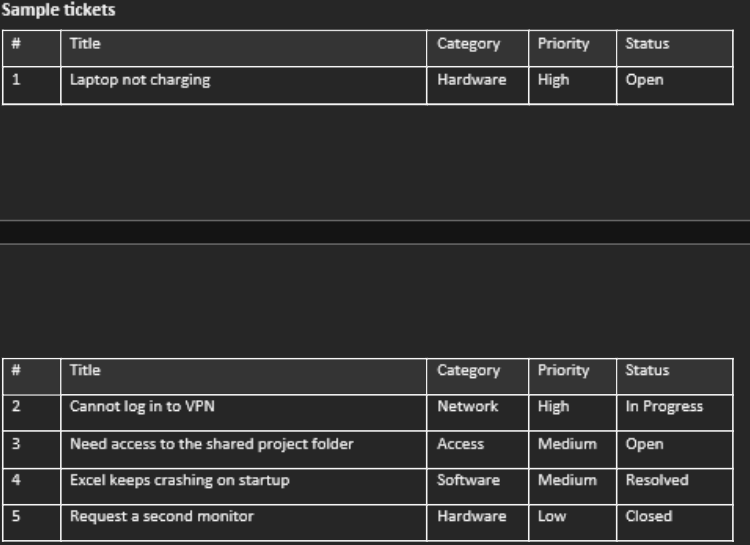

Problem: Employees have no simple way to raise IT support requests and track them.
Users: Employee (submits tickets, sees status, adds comments); Support staff (sees all tickets, changes status).
Ticket fields: Title (required, max 100 characters), Description (required), Category (Hardware, Software, Network, Access, Other), Priority (Low, Medium, High), Status (Open → In Progress → Resolved → Closed; set by app, changed by support staff), Created by, Created date and Last updated date (both automatic).
Rules: Only support staff can change status. Employees see only their own tickets; support staff see all. A Closed ticket can’t be edited but can still receive comments. Title and description can’t be empty.
Limits: Small web app, Python/Flask + SQLite, no real data, no secrets in code, simple login with two seeded demo users.
Sample tickets: 